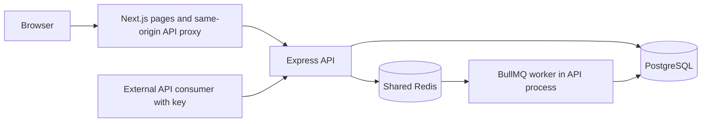
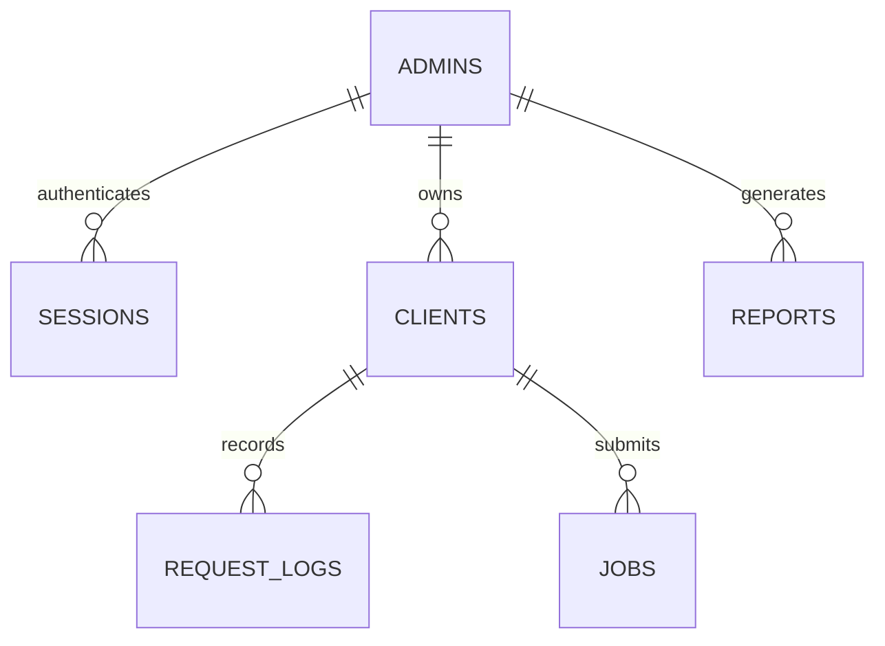

# QueueShield: implementation audit and project-review handbook

Audit date: 10 October 2026. This describes the repository implementation, not a hypothetical finished gateway. The validation record at the end distinguishes tests run locally from deployment work that needs hosting accounts and credentials.

## 1. Explain the project in a minute

QueueShield is a distributed API rate-limiter demonstration with a personal management console. Each registered API consumer receives a secret API key, a request budget, a time window, and either Token Bucket or Sliding Window Log. Multiple backend processes share Redis, which makes each admission decision atomically. PostgreSQL stores accounts, client configuration, decision history, and background-job records. Accepted probes create durable job records and are processed by BullMQ workers. A Next.js console displays only the signed-in account’s clients and traffic.

The limiter is currently applied to `GET /api/probe`. It is not a reverse proxy that forwards arbitrary third-party APIs. The worker demonstrates background execution with a 200 ms task; it does not send real emails, process payments, or run user-supplied code. Algorithm Lab is a separate browser simulation. These boundaries matter in a project review.

## 2. Local startup: Docker, recommended for using the application

Prerequisite: Docker Desktop running with Linux containers and Compose v2. Host Node.js is unnecessary for this option. Run from the repository root.

First setup only: copy `.env.example` to `.env`, then replace all three secret placeholders. This PowerShell snippet generates them without displaying them:

```powershell
Copy-Item .env.example .env
$config = Get-Content .env -Raw
foreach ($name in @('JWT_SECRET', 'APP_PROXY_SECRET', 'API_KEY_SECRET')) {
  $bytes = New-Object byte[] 32
  $rng = [Security.Cryptography.RandomNumberGenerator]::Create()
  $rng.GetBytes($bytes)
  $rng.Dispose()
  $config = $config -replace "(?m)^$name=.*$", "$name=$([Convert]::ToBase64String($bytes))"
}
[IO.File]::WriteAllText((Join-Path $PWD '.env'), $config)
docker compose up --build -d
docker compose ps
```

Do not overwrite an existing `.env` when restarting. In particular, preserve `API_KEY_SECRET`: it is needed to decrypt stored client keys. `.env` files are ignored by Git and excluded from image build contexts.

| Service | Local address | Role |
| --- | --- | --- |
| Next.js frontend | http://localhost:3000 | Production standalone server, pages, API proxy |
| Express backend | http://localhost:4000 | Authentication, configuration, limiter, history, worker |
| PostgreSQL | localhost:5432 | Database `queueshield`, local user `queueshield` |
| Redis | localhost:6379 | Shared limit state, auth throttles, BullMQ |

The local database password defaults to `queueshield`. These ports bind to `127.0.0.1`, so this Compose setup is for localhost. For a new database you can choose a different `POSTGRES_PASSWORD`; changing the variable does not change the password of an already initialized PostgreSQL volume. Use managed, private databases and their own credentials when deploying.

Useful commands:

```powershell
docker compose logs -f web api
docker compose logs --tail 50 postgres redis
Invoke-RestMethod http://localhost:4000/health
Invoke-RestMethod http://localhost:4000/ready
docker compose stop
docker compose start
docker compose down
```

`down` removes containers and their network but retains named database volumes. Do not add `-v` unless you intend to erase the stored data. After code changes use `docker compose up --build -d`; `restart` alone does not rebuild an image.

Stop host development servers occupying ports 3000/4000 before starting those containers. Alternatively change `WEB_PORT` and `API_PORT` in root `.env`. `DB_PORT` and `REDIS_PORT` can also be changed for a separate test stack. The backend’s browser-origin setting follows `WEB_PORT` automatically in Compose.

Docker runs a compiled production frontend, which avoids development compilation and hot-reload overhead. Docker itself is not a speed guarantee: host resources, database latency, and request volume still determine performance.

## 3. Local startup: development and debugging

Prerequisites: Node.js 22, npm, and Docker Desktop. Use three terminals. From the root, initialize root `.env` as above before invoking Compose; interpolation validates its secret variables even when starting only the datastores.

Terminal 1:

```powershell
docker compose up -d postgres redis
```

Terminal 2:

```powershell
cd server
Copy-Item .env.example .env
npm ci
npm run db:migrate
npm run dev
```

Set `JWT_SECRET`, `API_KEY_SECRET`, and `APP_PROXY_SECRET` in `server/.env` to your actual values before migrating. If this is the same database previously used by Docker, use the same `API_KEY_SECRET` as root `.env`; otherwise existing encrypted keys cannot be opened. Development allows a blank proxy secret, but production requires all three secrets to contain at least 32 characters. Development should also use generated secrets.

Terminal 3:

```powershell
cd web
Copy-Item .env.local.example .env.local
npm ci
npm run dev
```

`web/.env.local` uses `API_URL=http://localhost:4000`; its proxy secret must match the backend if configured. The browser always requests `/api/...` on the frontend origin. `NEXT_PUBLIC_API_URL` is no longer used. Restart a running service after changing environment variables.

To run compiled applications without Docker:

```powershell
# server terminal
npm run build
npm run db:migrate:prod
npm start

# web terminal
npm run build
npm start
```

The web postbuild script copies static assets into Next’s standalone directory. `npm start` launches that server. You can use `PORT` to select another production-preview port and `NEXT_BUILD_DIR` to isolate its build output from a running dev server. Add that preview origin to backend `WEB_ORIGINS`; keep the same build directory when starting the preview.

## 4. Deployment: Vercel frontend and Render backend

### Render

The repository includes `render.yaml` and a backend Dockerfile. Create a Docker web service with Docker context `server`, Dockerfile `server/Dockerfile`, and health-check path `/ready`. The image compiles TypeScript, installs runtime dependencies only, runs migrations, and then starts Express on `0.0.0.0:$PORT`. Render supplies `PORT`; do not hard-code a public port in its dashboard.

Provide:

| Setting | Value or meaning |
| --- | --- |
| `NODE_ENV` | `production` |
| `DATABASE_URL` | PostgreSQL connection URL, preferably private and in the same region |
| `REDIS_URL` | Redis/Render Key Value connection URL; `rediss://` when TLS is required |
| `JWT_SECRET` | Random signing secret, at least 32 characters |
| `API_KEY_SECRET` | Different random encryption secret, at least 32 characters; back it up securely |
| `APP_PROXY_SECRET` | Shared random secret with Vercel, at least 32 characters |
| `WEB_ORIGINS` | Exact frontend origin, for example `https://your-project.vercel.app` |
| `TRUST_PROXY` | `1` for the single Render ingress proxy; verify when adding other proxies |
| `DB_POOL_SIZE` | Default 10; reduce if your database plan has few connections |
| `ALLOW_REGISTRATION` | `true` by default; set `false` after creating accounts if access should be closed |

Use your provider’s verified PostgreSQL TLS settings and certificate chain. The application does not disable certificate verification. Keep PostgreSQL and Redis private where possible. Configure Redis with `noeviction`, and enable persistence for durable queues. The default worker runs inside the backend process, so no separate paid worker service is required for this project.

### Vercel

Import the repository with Root Directory `web`, Next.js framework, Node.js 22, and build command `npm run build`. Vercel manages the frontend runtime; it does not use the local frontend Docker image.

Set server-side environment variables:

```text
API_URL=https://your-api.onrender.com
APP_PROXY_SECRET=<the same value configured on Render>
```

Do not prefix these values with `NEXT_PUBLIC_`. Redeploy after changing hosting environment variables. Add your final Vercel/custom-domain origin to Render `WEB_ORIGINS`. Preview deployments need their exact allowed origins too; avoid allowing arbitrary sites or all preview domains.

The browser calls its own Vercel origin. `web/app/api/[...path]/route.ts` forwards a limited set of paths and headers to the configured backend, including session cookies and the backend’s `Set-Cookie` response. This keeps cookies first party rather than depending on third-party cookie support between `vercel.app` and `onrender.com`. Cookies omit `Domain`, so the browser associates them with the frontend host. The proxy adds the shared secret and, on Vercel, its platform-provided client IP; Express only trusts that custom IP when the secret matches.

After deployment verify registration/login, refresh, logout, password change, two separate accounts, client creation, a probe, completed jobs, and mobile navigation against the actual public URLs. Local tests cannot prove your hosting credentials, DNS, proxy configuration, database TLS, or provider resource limits are correct.

### External cron: every ten minutes

Use an external scheduler such as cron-job.org:

```text
URL: https://your-api.onrender.com/health
Method: GET
Schedule: */10 * * * *
Expected status: 200
Authentication: none
```

Use the backend URL directly, not the Vercel API proxy and not `/api/probe`. `/health` is cheap, uncached, public, and creates no account, traffic, or job records. It returns `{ ok: true, service: "queueshield-api", uptime: ... }`. `/ready` separately checks PostgreSQL and Redis and returns 503 if either is unavailable; use it for Render’s health check and monitoring.

Render currently idles free web services after 15 minutes without incoming traffic. Ten-minute pings can reduce idle sleeps, but they do not guarantee availability or bypass monthly quotas, restarts, or provider restrictions. Free PostgreSQL expires after 30 days, and free Key Value does not persist data through restarts. Use durable hosting and backups for real production data. These are hosting limitations, not conditions the health endpoint can fix. See [Render’s free-service documentation](https://render.com/docs/free) and [health-check documentation](https://render.com/docs/health-checks).

## 5. Architecture and request paths



An account session authorizes management actions. A client API key authorizes probe requests. These are different credentials with different purposes: do not give an API consumer the account’s session JWT.

Probe flow:

1. Require a bounded-length `x-api-key`; hash it with SHA-256 and find the matching client.
2. Reject unknown keys and unowned legacy clients with 401.
3. Read current limit, window, algorithm, and configuration revision from PostgreSQL.
4. Execute one Redis Lua script using Redis’s clock.
5. Await the PostgreSQL decision-log insert. Failure does not silently produce a successful probe.
6. For a rejection, return 429 with `Retry-After` in seconds and remaining capacity.
7. For an admission, insert a PostgreSQL job row, then enqueue it under deterministic BullMQ ID `db-<jobId>`.
8. Return 200 when queued. If enqueue fails after the durable row exists, return 202 explaining that queue recovery is pending.
9. The worker records processing, waits 200 ms to simulate work, and records completion. Retry/backoff and reconciliation handle interruptions.

### Reviewer API-key demonstration

This is the clearest live demonstration of the limiter. Create a client with a limit of `5` requests in `60` seconds and choose Sliding Window. On the Clients page, use **Copy API key**, paste the value into the PowerShell variable below, then run it while Overview is open:

```powershell
$key = 'PASTE_THE_CLIENT_API_KEY_HERE'
1..7 | ForEach-Object {
  curl.exe -sS -i -H "x-api-key: $key" http://localhost:4000/api/probe
}
```

The first five calls return `200` and include `X-RateLimit-Status: allowed`; the next two return `429`, `X-RateLimit-Status: blocked`, and `Retry-After`. Within the Overview refresh interval, the dashboard shows Total requests `7`, Allowed `5`, and Blocked `2`. Activity shows all seven decisions, while Jobs shows only the five allowed requests because blocked requests never create work.

For Docker with a custom `API_PORT`, replace `4000` with that port. After deployment, use the Render backend origin such as `https://your-api.onrender.com/api/probe`; external API consumers should call that backend directly, not the Vercel frontend.

Redis and PostgreSQL do not share a distributed transaction. A dependency failure can consume a token even if a later database write fails. The application fails closed rather than allowing uncounted work. The decision log reports limiter decisions; an allowed decision alone does not prove a downstream job completed. The Jobs screen supplies that separate state.

## 6. Algorithms: equations, state, and concurrency

### Token Bucket

Capacity `C = rateLimit`; refill rate `r = C / windowSeconds` tokens/second. On a request at time `now`:

```text
tokens = min(C, tokens + max(0, now - previousTime) / 1000 * r)
allow if tokens >= 1, then subtract 1
retry delay = ceil((1 - tokens) / r * 1000) milliseconds when blocked
```

Redis stores a hash with `tokens` and `ts`. It permits an initial burst up to capacity and refills continuously. A capacity of 5 over 10 seconds refills one token every two seconds. Fractional tokens are retained, but fewer than one token cannot admit a request. Remaining capacity is rounded down for the response. The state expires after roughly the full refill duration plus one second.

### Sliding Window Log

Redis stores a sorted set: timestamp scores and random UUID members for admitted requests. For each request it removes entries at or before `now - window`, counts the remaining entries, and admits only if count is below the limit. Blocked attempts are not added to the sorted set. The oldest admitted timestamp determines the retry delay. A request exactly one window old expires. The set’s TTL is refreshed to the window duration.

Both algorithms permit simultaneous arrivals while capacity is available. Sliding Window Log is not a leaky bucket that evenly spaces every request. Token Bucket has approximately O(1) work and constant state per client; sorted-set operations need O(log N) insertion plus expired-entry cleanup and O(N) state up to the configured budget.

### Why distributed decisions remain consistent

Lua executes atomically on the shared Redis server, avoiding a read-count/write race between API instances. Both algorithms use Redis `TIME`, avoiding disagreement between backend machine clocks. Keys include client ID, algorithm, and configuration revision: `rl:tb:<id>:<revision>` or `rl:sw:<id>:<revision>`. Updating client configuration increments the revision and starts a fresh budget; previous state expires naturally.

This implementation expects a normal single Redis endpoint, as supplied by the local stack or a managed Redis service. It does not configure Redis Cluster, multi-region consensus, or automatic failover. Redis loss can reset budgets; persistence and infrastructure redundancy are operational concerns.

## 7. Data model and ownership



| Table | Fields and purpose |
| --- | --- |
| `admins` | Serial ID; name; unique normalized username/email; bcrypt password hash; optional phone/avatar; JSON notification booleans; creation timestamp |
| `sessions` | Random 64-character session ID; admin foreign key; remember flag; expiry timestamp |
| `clients` | ID; owner `admin_id`; name; encrypted API key; unique key hash; tier; request limit; window seconds; algorithm; configuration revision; creation timestamp |
| `request_logs` | ID; client foreign key; endpoint; allowed/blocked decision; algorithm used at that time; timestamp |
| `jobs` | ID; client foreign key; job type; JSON payload; queued/processing/completed/failed state; retry count; creation/completion timestamps |
| `reports` | ID; account; report type; start/end dates; generated timestamp. Reserved schema; saved-report generation is not exposed by the API |

Timestamps use `timestamptz`; ISO responses contain a timezone, while the browser formats them locally. Dates in the unused saved-report schema are calendar dates. The ownership migration explicitly interprets earlier timezone-less timestamps as UTC.

Unique indexes protect usernames, emails, API-key hashes, and stored keys. Additional indexes cover client ownership, client/time request history, client/time job history, and job status. A serial ID is an internal identifier, not a secret or an authorization mechanism.

Every management query is filtered by the authenticated account. History and reports join through `clients.admin_id`; mutations match both owner and client ID. Sending another account’s ID in a JSON body cannot transfer ownership. Foreign-client edits/deletes return the same 404 as a nonexistent client.

Deleting an account cascades through its sessions, clients, logs, jobs, and reports. Deleting one client removes that client’s logs and jobs. Queued Redis jobs whose database record was deleted safely do no work. Other accounts’ records remain intact. Redis job metadata may remain until its bounded queue-retention policy removes it; database deletion is not an immediate purge of every Redis structure or external backup.

### Why a new account previously displayed traffic

The earlier schema had no client owner, and list/report queries selected the whole workspace. The new implementation scopes all data to the account. A genuinely new account receives zero requests, zero clients, empty Activity, and empty Jobs; no demo traffic is inserted at signup.

Old clients have `admin_id = NULL` because their creator was never recorded. Guessing ownership could leak keys or traffic again. They are preserved, hidden from all personal consoles, and their probe keys are rejected. To recover a specific legacy client, verify its real owner, note both IDs, and run:

```powershell
cd server
npm run client:assign -- CLIENT_ID ADMIN_ID
```

Replace the symbolic arguments with actual numeric IDs. The operator-only command assigns only an unowned client, validates its limits, rotates the old key, encrypts the new key, and increments its revision. The owner can then copy the new key from Clients. It requires direct database credentials and should never become a public HTTP endpoint.

Migrations live in `server/drizzle`; Drizzle tracks applied files in PostgreSQL. The runner obtains a PostgreSQL advisory lock so two starting API instances do not race migrations. It also encrypts any already-owned plaintext keys from an intermediate development version. Never edit an already-applied migration to change a deployed database: generate a new migration instead.

## 8. Authentication and account lifecycle

Passwords are validated on the server and hashed with bcrypt cost 12. The maximum is 72 UTF-8 bytes, not merely 72 visible characters, because bcrypt otherwise truncates longer input. The policy requires 12–72 characters with uppercase, lowercase, a number, and a symbol. Passwords are not normalized, trimmed, logged, or stored in plaintext.

Usernames normalize to lowercase, need a letter, permit only letters/numbers/underscore/hyphen, and have length 3–24. Reserved names include admin/support/root/moderator/null and other staff-like values. Email addresses normalize to lowercase. Database uniqueness handles concurrent registrations, and duplicate conflicts return 409.

The breached-password check computes SHA-1 solely for the HIBP range lookup. Only the first five hexadecimal hash characters leave the backend; matching the remaining suffix happens locally. Response padding reduces information from response size. SHA-1 is not used for password storage. An unavailable/malformed breach response rejects the operation with 503 rather than bypassing the check. Each range request has a five-second timeout and one retry for transient service failures; the check still fails closed.

Registration and its initial session are transactional. Login compares against a dummy bcrypt hash for nonexistent accounts to reduce timing differences. A JWT is signed with HS256 and contains account ID, random session ID, issue/expiry times. It also requires a live, unexpired database session joined to the account; a valid signature alone is insufficient after logout or password change.

| Action | Result |
| --- | --- |
| Login without Remember me | Browser-session cookie; server expires session after 12 hours |
| Login with Remember me | Persistent cookie and server expiry for 30 days |
| Logout | Revoke current session and clear cookie |
| Change email | Require current password; revoke other sessions |
| Change password | Require current password and matching new entries; reject unchanged/breached password; revoke all sessions and require login |
| Delete account | Require current password and exact `DELETE`; erase owned database records and clear cookie |

Cookie `qs_session` is HttpOnly, SameSite=Lax, path `/api`, and Secure in production. JWTs are not kept in localStorage. The frontend removes obsolete localStorage auth values and remounts account-dependent page state when the account ID changes. API 401 responses on authenticated management calls send the user back to login.

There is intentionally no email-based forgotten-password recovery, email verification, OAuth, MFA, or email delivery. Changing a known current password is supported. Security/product email preferences are saved for future integration; traffic preferences control the real in-app blocked-request notice.

Authentication-sensitive endpoints are throttled to 30 attempts per route/IP per 15 minutes in Redis. This supplements password validation; it does not replace hosting-layer abuse protection. A verified Vercel client IP can be forwarded through the shared-secret proxy. Direct requests use Express’s configured proxy trust. Never set trust proxy to unrestricted `true` on an arbitrary public network.

## 9. API-key security and application security

Client keys use 20 cryptographically random bytes, encoded as `qs_` plus 40 hex characters: 160 bits of entropy. The database stores AES-256-GCM ciphertext with a random 12-byte IV and authentication tag, plus a SHA-256 lookup hash. Authenticated owners can retrieve decrypted keys for the existing Copy key and traffic-test flows. History/Jobs responses omit keys and payloads.

`API_KEY_SECRET` is hashed into the AES key. Losing it prevents decryption; changing it without re-encrypting records breaks owner key retrieval. Back it up separately from database dumps. Changing `JWT_SECRET` signs out existing sessions; it is not a substitute for rotating client keys. `APP_PROXY_SECRET` authenticates the proxy’s custom IP header, not the user. These secrets must differ and must not appear in Git, frontend bundles, URLs, screenshots, or request logs.

Other protections:

- Zod validates HTTP input on the server. Frontend validation is for usability, not a trust boundary.
- Drizzle parameterizes values. User input does not become SQL identifiers or arbitrary SQL snippets. ILIKE wildcard characters are escaped for literal history search.
- React escapes ordinary text. User avatars accept only bounded PNG/JPEG/WebP data URLs with matching file signatures; SVG/HTML uploads are rejected.
- Backend JSON bodies and streamed frontend-proxy bodies are capped at 256 KiB. Client configuration is bounded to integers 1–9,999.
- Mutating browser requests with a foreign `Origin` are rejected; CORS allows only exact configured origins. HttpOnly and SameSite are additional cookie protections, not replacements for authorization.
- A per-response CSP nonce authorizes Next’s scripts. `web/proxy.ts` supplies the policy before rendering. Pages are rendered dynamically so a cached static nonce is not reused.
- CSP restricts script, font, image, connection, form, and frame sources. Styles permit inline values because Motion and component CSS variables require them; fonts permit Google Fonts. Development alone allows unsafe evaluation for its tools and websocket connections.
- Headers prevent MIME sniffing and framing, restrict referrer data and unused device permissions, and set HSTS on HTTPS frontend responses. Backend production also sends HSTS. Express/Next powered-by headers are disabled.
- Structured API logs contain request ID, method, path without query, status, and duration. They exclude request bodies, cookies, API keys, passwords, and full database errors.
- Unknown endpoints return JSON 404. Invalid JSON returns 400; oversized bodies return 413. Dependency failures are bounded rather than waiting indefinitely.

This is a project-level application review, not an independent penetration test or a compliance certification. Before a public launch configure backups, least-privilege database access, monitoring, storage quotas/retention, and appropriate hosting-layer abuse controls. Close registration if only you need access.

## 10. Queue, retries, and recovery

BullMQ uses queue `background`, worker concurrency 5, and deterministic IDs derived from database job IDs. Jobs try at most three times, with exponential backoff starting at one second. This means the first execution plus at most two retries. `retryCount` records attempts already made, not a promise of exactly-once execution.

PostgreSQL is the durable source of pending-job records. Every five seconds, a non-overlapping reconciler scans up to 100 queued/processing probe jobs. Missing Redis jobs are added again; existing active/delayed/waiting jobs retain their IDs; terminal Redis states are reconciled with PostgreSQL. This repairs the database-insert/queue-add gap and recovers pending work after queue loss. Redis keeps at most 1,000 retained completed jobs for up to an hour, and at most 1,000 failed jobs for up to seven days.

The producer connection fails quickly on Redis outages; the worker uses BullMQ’s required reconnecting connection with `maxRetriesPerRequest: null`. They do not share an indefinite-retry policy for HTTP calls. See [BullMQ connection guidance](https://docs.bullmq.io/guide/connections).

Delivery is at least once. The demonstration task has no external side effect, so repeating it is harmless. Before adding payments, emails, or other side effects, implement idempotency keyed to the database job ID and test partial failures. A completed job is not automatically rerun after Redis loss because the reconciler selects only unfinished database records. Failed jobs remain visible; a manual retry/scheduling UI is not implemented.

SIGTERM/SIGINT stops accepting new HTTP work, drains requests, closes the worker/queue, closes Redis, and ends the PostgreSQL pool. A 25-second deadline prevents a hung shutdown; Compose permits 30 seconds. Pending PostgreSQL records allow recovery after a forced termination. Free Render sleep also stops the embedded worker until the service wakes.

## 11. Every screen and important UI detail

| Screen | Implementation and behavior |
| --- | --- |
| Login/register | Two-column story/form on desktop; single column on mobile; controlled fields; show/hide password; Remember me; inline validation and loading skeletons |
| Overview | Account totals, last-hour minute buckets, per-client bars, latest 50 decisions, real traffic playground, 2.5-second polling |
| Activity | Server-side literal search, decision/algorithm/time filters, pages of 25, newest first, current-page CSV export |
| Clients | Register consumers, select tier/algorithm, edit numeric budget/window, copy API key, reversible fuse before deletion |
| Jobs | Search ID/type/client, status/time filters, pages of 25, retry counts and timestamps, animated state chips |
| Algorithm Lab | Local Token Bucket/Sliding Window comparison, manual clock, burst dial, guided example, most recent 12 experiments |
| Settings | Profile/photo, notification bells/preferences, current-password change, account deletion, draggable/tilting flip card |

### Design tokens and CSS teachers may ask about

`web/tailwind.config.ts` supplies named colors and fonts; `web/app/globals.css` holds shared classes and layout rules. Tailwind 4 loads the existing config through `@config`; `@tailwindcss/postcss` compiles the utilities. Reusable classes include `.panel`, `.btn`, `.field`, `.badge`, `.metric`, `.data-table`, and `.settings-card`.

| Detail | Exact mechanism |
| --- | --- |
| Green text selection | `::selection { background: #d7edb6; color: #18372a; }` in `globals.css` overrides the browser’s blue selection colors |
| Always-light interface | `:root { color-scheme: light; }`, explicit background/foreground colors, no automatic dark-mode classes |
| Main background | Body `#f7f8fa`; ink `#202923`; white panels with `#e1e5de` borders |
| Green and blocked accents | `mint: #287451`; `rose: #ba513c`; matching pale badge fills |
| Fonts | Inter for interface text, JetBrains Mono for IDs/numbers; Google Fonts stylesheet in root layout; system font fallbacks |
| Stable numeric widths | `.num` uses monospaced font, `tabular-nums`, tight tracking; metric values also use tabular numbers |
| Crisp text | `-webkit-font-smoothing: antialiased` on the body |
| Keyboard focus | `:focus-visible` adds a green 2 px outline with 3 px offset; skip-to-content link appears when focused |
| Mobile tap flash | `-webkit-tap-highlight-color: transparent` removes the default tap highlight |
| Card style | Bordered white panels and spacing; original FlipCard supplies its own motion/shadow behavior through props |
| Layout | Fixed 216 px sidebar on desktop, content max width 1,440 px, 68 px topbar; sidebar becomes an inline mobile bar below 1,024 px |
| Small screens | Below 640 px, content padding/topbar/metrics shrink; wide tables scroll inside their own containers |
| Skeletons | `.skeleton` uses a muted background and 1.5-second opacity pulse; screen-reader loading status accompanies hidden decorative blocks. Workspace navigation keeps the sidebar/header visible and swaps only the destination content for its matching skeleton. |
| Entrance motion | `.rise` fades/translates by 6 px over 350 ms |
| Reduced motion | CSS disables transitions/keyframes; original components also use Motion’s reduced-motion hook and simplified interaction paths |
| Browser title | Next root `metadata` sets QueueShield title/description; `<html lang="en">` sets document language |
| Profile photo | Browser validates type/2 MB source limit, center-crops to 256×256 canvas, encodes WebP at quality 0.85, closes the bitmap, and saves a data URL |
| Password visibility | A local boolean switches `type=password/text`; the button reports its pressed state and never submits the form |

### Supplied Reactbits source

The supplied implementations live in `web/components/reactbits/`. Application wrappers configure props, colors, dimensions, callbacks, and state without rewriting their animation logic. The six attached originals remain byte-for-byte unchanged; RubberSegment comes from the supplied bundle and FlipCard from the supplied chat code.

| Original | Where and how it is used |
| --- | --- |
| `CodeSlots` | `NumberEntry`: four digit slots for client limits/windows, 1–9,999; Lab uses three slots for its smaller ranges. Slot/cascade behavior comes from the original |
| `CometDial` | Traffic-test request count, and Lab burst size; original momentum/trails and pointer/keyboard controls |
| `FuseButton` | `FuseDelete`: four-second delayed delete with Undo/Escape and pause behavior; committing calls the API |
| `BranchedMenu` | Sidebar groups; original trunk/branches/open-close animations; mobile Browse button contains the same menu |
| `BellToggle` | Notification preferences; controlled `pressed` value and original ring/wave motion |
| `CallChip` | Job status: idle/queued, running/processing, done/completed, error/failed |
| `RubberSegment` | Activity/Jobs status filters with the original elastic indicator |
| `FlipCard` | Account summary: pointer tilt/glare, drag or tap to turn, keyboard interaction, reduced-motion fallback |

`motion/react` supplies motion values, transforms, springs, and reduced-motion preferences. Hugeicons supplies icons used inside the original components; the rest of the app uses the small SVG `Icon` component. Some global compatibility/visibility rules remain for original component states. Tailwind 4 now supports the newer utility syntax directly.

Numeric input has a hidden native number field for form validity and the original visible text/slot control. Digits are bounded on both client and server; an invalid draft cannot silently submit the last valid value. Inline edits require Save number or Enter. A client update starts a fresh revision/budget.

### Charts, polling, filters, exports

Recharts `ResponsiveContainer` sizes an `AreaChart`. Allowed requests use a solid green area, blocked requests a dashed red area. Animation is disabled on chart refresh to avoid reanimating every poll. Timestamps are full ISO minute buckets; axis labels format local time, and tooltips show the full local date/time. Grouping by full date prevents different days from merging; per-client grouping uses ID, so duplicate names remain distinct. The chart covers the rolling last hour and includes recorded buckets, not synthetic traffic.

Overview skips overlapping polls, stops old requests on unmount, and pauses periodic fetching in hidden tabs. Activity/Jobs debounce search by 250 ms, abort stale filter requests, and poll every five seconds. Initial/filter loads use skeletons; background refresh keeps prior rows visible and labels failures. These are polling updates, not WebSockets or SSE.

CSV export is browser-generated with UTF-8 BOM, CRLF rows, quoted/escaped fields, and formula-prefix neutralization. It exports the visible Activity page, not all history. Search/filter/count/pagination are server-side; client-directory search filters the returned personal client list locally.

## 12. API reference and status meanings

All protected routes accept the session cookie; API tools can supply the same session JWT as `Authorization: Bearer ...`. A JWT without a live session is rejected. Browser calls go through the frontend proxy; machine probes can call Render directly.

| Method | Backend path | Input/result |
| --- | --- | --- |
| POST | `/api/auth/register` | name, username, email, password, confirmPassword, optional remember; 201 + cookie |
| POST | `/api/auth/login` | email, password, optional remember; cookie |
| GET | `/api/auth/me` | Current profile and session expiry |
| PATCH | `/api/auth/me` | name, username, email, phone, avatar; currentPassword for changing email |
| PATCH | `/api/auth/notifications` | securityAlerts, trafficAlerts, productUpdates booleans |
| POST | `/api/auth/password` | currentPassword, newPassword, confirmPassword |
| POST | `/api/auth/logout` | Revoke current session; 204 |
| DELETE | `/api/auth/me` | currentPassword and confirmation `DELETE`; 204 |
| GET/POST | `/api/clients` | Own clients / create name, tier, rateLimit, windowSeconds, optional algorithm |
| PATCH/DELETE | `/api/clients/:id` | Own client only; edit config / remove client and linked data |
| GET | `/api/probe` | `x-api-key`; 200 queued, 202 durable pending enqueue, or 429 blocked |
| GET | `/api/reports/stats` | Own all-recorded allowed/blocked totals |
| GET | `/api/reports/timeseries` | Own recorded minute buckets over the last hour |
| GET | `/api/reports/per-client` | Own traffic grouped by client ID/name |
| GET | `/api/reports/logs` | Latest 50 own decisions |
| GET | `/api/history/activity` | q, status, algorithm, period, page |
| GET | `/api/history/jobs` | q, status, period, page |
| GET/HEAD | `/health` | Public process liveness; no database work |
| GET/HEAD | `/ready` | Public DB/Redis readiness; 200 or 503 |

History returns `{ rows, counts, total, page, limit: 25 }`. `period` is `all`, `24h`, or `7d`. Activity status is all/allowed/blocked; algorithm is all/token_bucket/sliding_window. Job status is all/queued/processing/completed/failed. Counts reflect the current filters. Page is an integer from 1 to 100,000. Queries use stable timestamp/ID ordering.

Client tier is free/pro/enterprise and is currently a label; it does not bill users or select automatic limits. Limits/windows are positive integers up to 9,999. Algorithm is token_bucket or sliding_window.

| Status | Meaning |
| --- | --- |
| 200 / 201 / 204 | Success / created / success with no response body |
| 202 | Probe accepted and stored, queue delivery pending recovery |
| 400 | Invalid values, invalid JSON, malformed ID/filter, mismatching password confirmation |
| 401 | Invalid/missing session or API key |
| 403 | Wrong current password, disallowed origin, or closed registration |
| 404 | Unknown route or client unavailable to this owner |
| 409 | Uniqueness conflict or account changed during a sensitive operation |
| 413 | Body exceeds 256 KiB |
| 429 | Client limit exceeded or auth attempt throttle; inspect body/Retry-After |
| 500 | Unexpected server error; generic message, no internal stack |
| 503 | Required dependency or password safety check unavailable; retry later |

Probe responses include `X-RateLimit-Limit`, `X-RateLimit-Remaining`, and `X-RateLimit-Status`. Blocked probes also include `Retry-After`, rounded up to whole seconds. Response headers are forwarded through the frontend API proxy. There is no `X-RateLimit-Reset` header in this implementation.

## 13. Source map for review and debugging

| Files | Responsibility |
| --- | --- |
| `server/src/index.ts` | Express middleware, health/readiness, route mounting, errors, logging, shutdown |
| `server/src/env.ts` | Validated environment and production secret requirements |
| `server/src/db/schema.ts` | Six PostgreSQL table definitions, relations, indexes |
| `server/src/db/client.ts` | Bounded PostgreSQL connection pool and Drizzle |
| `server/src/db/migrate.ts`, `server/drizzle/` | Serialized schema migration and owned-key encryption |
| `server/src/db/assign-client.ts` | Operator-only verified legacy-client assignment/rotation |
| `server/src/lib/auth.ts` | Cookies, JWTs, session checks, throttle, async route wrapper |
| `server/src/lib/account.ts` | Username/password rules and HIBP lookup |
| `server/src/lib/keys.ts` | API-key encryption, decryption, hashing, safe client representation |
| `server/src/routes/` | Account, owned clients, probe, reports, history endpoints |
| `server/src/ratelimit/` | Atomic Redis algorithms and decision logging |
| `server/src/redis.ts`, `queue.ts` | Fail-fast HTTP Redis connection, BullMQ worker and reconciliation |
| `web/app/layout.tsx`, `page.tsx` | Metadata, fonts, auth provider, entry routing |
| `web/app/*/page.tsx` | Six protected screens and login |
| `web/app/*/loading.tsx`, `components/Skeleton.tsx` | Route/data loading UI |
| `web/app/error.tsx`, `not-found.tsx` | Recoverable page-error and missing-page UI |
| `web/proxy.ts`, `next.config.mjs` | CSP nonce, security headers, standalone build |
| `web/app/api/[...path]/route.ts` | Bounded same-origin backend proxy |
| `web/lib/auth.tsx`, `api.ts`, `history.ts` | Session state, requests/timeouts, polling/filter cancellation |
| `web/lib/simulator.ts`, `csv.ts` | Deterministic Lab algorithms and safe CSV generation |
| `web/components/` | Shell, SVG icons, charts, forms, supplied-component wrappers |
| `web/components/reactbits/` | Original supplied interactive component implementations |
| `web/scripts/standalone.mjs` | Copy standalone assets and launch compiled server |
| Dockerfiles, Compose, `render.yaml` | Container builds/local stack/Render preparation |
| `server/tests/`, `web/tests/` | Unit/integration/browser verification |

## 14. Operations, troubleshooting, and backups

| Symptom | Check |
| --- | --- |
| Couldn’t connect to account | Backend `/ready`; frontend API_URL; service logs; allowed browser origin |
| Login works then disappears | Cookie forwarded correctly; HTTPS/Secure setting; same JWT secret on API instances; active session row |
| New account has no old clients | Expected isolation. Legacy clients need verified explicit assignment, never automatic sharing |
| Client keys cannot be displayed | Correct API_KEY_SECRET for that database; do not regenerate it on restart |
| Password registration returns 503 | HIBP outbound HTTPS access/timeouts; operation deliberately fails closed |
| Probe returns 401 | Correct current key; client still exists and has an owner; legacy keys need operator recovery |
| Probe returns 429 | Remaining capacity/Retry-After; selected algorithm; tests use real traffic and spend capacity |
| Jobs stay queued | Worker process alive; Redis and DB ready; same Redis database; noeviction; inspect API logs |
| DB ready but application reports errors | Confirm migrations ran and the service uses the intended database, not a different local/hosted URL |
| Docker port already allocated | Stop the project process using it or change root host-port settings |
| Configuration changed but behavior did not | Rebuild containers for code changes; restart/redeploy for environment changes |
| First hosted request is slow | Render free-tier cold start; cron is not a guaranteed availability service |
| Missing old chart points | Chart covers the last hour; older events remain searchable in Activity |

Pool defaults: maximum 10 PostgreSQL connections per API instance, three-second acquisition/connect timeout, ten-second statement timeout, 30-second idle timeout. Count all instances/workers when sizing managed DB capacity. Redis HTTP commands have three-second command/connect timeouts and one retry; the worker reconnects separately.

PostgreSQL stores historical data without automatic retention deletion. Monitor database growth and define an explicit retention/aggregation policy before sustained public load. Purging logs changes totals because current reports are computed from retained decision records. Redis queue retention is bounded separately; expiring limiter state is not historical storage.

For a local binary backup, avoid redirecting binary output through older PowerShell versions:

```powershell
docker compose exec postgres pg_dump -U queueshield -Fc -f /tmp/queueshield.dump queueshield
docker compose cp postgres:/tmp/queueshield.dump ./queueshield.dump
```

Store dumps outside Git, encrypted, with access controls. Back up secrets separately. Restore into an empty test database first, run `pg_restore` against that database, then verify accounts, ownership, migrations, and key decryption before considering any production replacement. Managed backups should include restore testing. Render free PostgreSQL has no managed backups; do not rely on it as the sole durable copy.

## 15. Typical teacher questions: short answers

1. **Why Redis and PostgreSQL together?** Redis makes fast atomic admission/queue operations; PostgreSQL provides durable relational ownership and history.
2. **What is distributed here?** Independent API processes share one Redis budget for each client; verified by alternating concurrent requests across two API instances.
3. **Why not a JavaScript Map?** Each process would have its own counters, permitting extra requests and losing state on restart.
4. **What race does Lua prevent?** Two servers cannot both observe the last free slot and each admit a request; the read/check/write sequence is atomic.
5. **Why Redis time?** All API instances use the same time source for rate decisions.
6. **Can Token Bucket allow a burst?** Yes, up to capacity; then it refills continuously.
7. **Can Sliding Window allow a burst?** Yes, if its recent-request budget is available; it is not even spacing.
8. **Why sorted-set members need UUIDs?** Several requests can share the same millisecond; a reused member would overwrite an existing entry and undercount.
9. **Do blocked requests consume sliding-window slots?** No. They are logged but not inserted into its admitted-request set.
10. **What happens when settings change?** The revision increments and the next request uses a fresh state key.
11. **Does tier control pricing or limits?** No. It is a classification label; actual numerical limits are explicit.
12. **Why four digit boxes?** The supported client budget/window is 1–9,999; ten slots were unnecessary and awkward.
13. **Are numbers validated only in React?** No. Native form validity and Zod server validation enforce the same bounds.
14. **Why did a fresh account show old traffic before?** The old schema had no owner, and queries were global. Owner-filtered joins/mutations now isolate data.
15. **Can changing a client ID in the URL expose another account?** No. Updates/deletes also require the signed-in owner ID and return 404 otherwise.
16. **Why not assign old records to the first account?** No creator information exists; guessing could leak another person’s keys and history.
17. **Is an API key the same as a login JWT?** No. The key identifies a managed consumer; the JWT/session authorizes account management.
18. **Why hash API keys with SHA-256 rather than bcrypt?** Keys have 160 random bits; lookup requires a deterministic indexed hash. Human passwords need slow guessing resistance.
19. **Why also encrypt keys?** The owner’s Copy key/test functionality needs retrieval; AES-GCM protects the stored recoverable value and authenticates ciphertext.
20. **Why is SHA-1 present?** HIBP’s range protocol uses it for breach lookup. Stored passwords use bcrypt.
21. **Does HIBP receive the password?** No. It receives a five-character hash prefix; suffix matching stays local.
22. **Why stop signup if HIBP is down?** Silently skipping a required password check would weaken the promised policy.
23. **Why both JWT and a sessions table?** JWT signatures validate authenticity; the table enables immediate revocation and server-side expiry checks.
24. **Does HttpOnly prevent every XSS attack?** No. It blocks JavaScript from reading the cookie; XSS could still act as the user, so escaping/CSP are also needed.
25. **What does SameSite do?** It limits when cookies are sent across sites. The same-origin proxy avoids relying on cross-site cookie delivery.
26. **What does Remember me store?** A persistent cookie and a 30-day database session, not the password.
27. **Is forgot-password recovery implemented?** No, by personal-project scope. A known current password can be changed with two matching new entries.
28. **Why revoke sessions after password change?** Existing tokens must stop working, including on other devices.
29. **Why require the password to change email/delete?** These sensitive actions deserve fresh proof of account access.
30. **Are uploaded photos files on Render’s disk?** No. The client crops/re-encodes them and stores a bounded image data URL in PostgreSQL.
31. **Why reject SVG avatars?** The supported photo flow needs raster images; accepting active markup adds unnecessary attack surface.
32. **How is selection green?** Global `::selection` background/foreground overrides, not JavaScript.
33. **How is light mode forced?** Explicit color tokens plus `color-scheme: light`.
34. **How do animations work?** Original supplied Reactbits code uses Motion values, transforms, and springs; wrappers connect real application state.
35. **Why keep wrappers?** Colors/state/API callbacks can change without rewriting the original component’s interactions.
36. **Why skeletons instead of a blank page?** They preserve layout and communicate loading; real requests determine when content appears.
37. **What happens with reduced motion?** CSS and component hooks remove or simplify animations while preserving controls.
38. **Are updates actually real time?** They use periodic polling, not a persistent socket.
39. **Why abort old searches?** A slow previous response must not overwrite a newer filter result.
40. **Why use full timestamp buckets?** Grouping only HH:MM merges the same clock minute from different days.
41. **Why group clients by ID?** Names can repeat; IDs distinguish their traffic.
42. **Does the CSV contain every event?** No. It exports the current Activity page; the UI states this.
43. **Why sanitize CSV formulas?** Spreadsheet software may execute cells starting with =, +, -, or @ as formulas.
44. **Why separate queues from HTTP work?** HTTP admission can finish promptly while workers perform tasks asynchronously.
45. **Is job processing exactly once?** No. At least once; real side effects require idempotency.
46. **What if the API dies between job insert and queue add?** The reconciler finds the durable pending row and enqueues it under the same deterministic ID.
47. **What if Redis loses pending jobs?** Unfinished PostgreSQL jobs can be re-enqueued; limiter budgets can reset, so persistence still matters.
48. **What is retry backoff?** A delay grows between retry attempts to avoid immediately hammering a failing dependency.
49. **Why different Redis retry policies?** HTTP callers need bounded failures; background workers should reconnect and resume.
50. **Why `/health` and `/ready`?** One measures the process cheaply; the other verifies critical dependencies.
51. **Does a health ping create traffic stats?** No. Only authenticated-key probes reach the limiter/log/queue path.
52. **Will cron guarantee Render never sleeps or fails?** No. It can reduce idle sleeps; quotas, restarts, and hosting availability still apply.
53. **Why build separate Docker stages?** Compilers/dev tools stay out of the runtime; the frontend copies traced standalone code and static assets.
54. **Do images contain local `.env` secrets?** No. Dockerignore excludes them; Compose/hosting injects runtime variables.
55. **Why run containers as `node`?** The application does not need root privileges.
56. **Why named volumes?** Database state survives container replacement; deleting volumes deliberately erases it.
57. **Does Docker make JavaScript faster?** The production build avoids dev overhead; containerization chiefly provides repeatable packaging.
58. **Why bind backend to 0.0.0.0?** Containers/Render must reach it through their network interfaces; localhost-only binding would hide the service.
59. **Why does frontend API_URL use `api` in Docker?** Compose DNS resolves service names; localhost inside the web container refers to that container itself.
60. **What is a migration?** A versioned schema change applied once; advisory locking prevents concurrent migration races.
61. **What is cascading deletion?** Foreign keys remove dependent owned rows when their parent account/client is deleted.
62. **Does deleting an account instantly erase backups?** No. Backup retention and Redis metadata are separate operational policies.
63. **What does 202 mean?** Accepted and durably pending, not completed; inspect Jobs for final state.
64. **What does 429 mean?** The request exceeded an applicable rate limit; Retry-After gives a retry interval.
65. **Is CORS authentication?** No. It is a browser cross-origin policy; sessions/owner checks authorize data access.
66. **What is CSP?** A browser policy constraining script/content sources. A unique nonce permits the framework’s legitimate scripts.
67. **Why dynamic rendering for CSP?** A fresh response must use a fresh nonce; a static cached HTML nonce would be unsafe or block scripts.
68. **What is HSTS?** An HTTPS response asks browsers to use HTTPS for future requests to the host.
69. **What gets logged?** Request ID/method/path/status/duration, without secrets or request bodies.
70. **How do you prove isolation?** Create two accounts, generate traffic only for one, verify the other’s lists/stats/history are empty, and attempt foreign-ID mutations.
71. **How do you prove concurrency correctness?** Send a simultaneous burst through two API instances with one Redis state and assert admissions equal the shared budget.
72. **What is still outside scope?** Generic upstream proxying, scheduled-job UI, real task side effects, full-history/saved reports, email recovery/delivery, billing, MFA, and enterprise infrastructure availability.

## 16. Verification commands and audit record

Server unit checks:

```powershell
cd server
npm run build
npm test
npm audit
```

Integration checks require migrated PostgreSQL, Redis, a running API/worker, and outbound HTTPS access to HIBP. The tests create unique fixture accounts/records and clean up only those fixtures. Start a second API with another `PORT` and the same database, Redis URL, encryption/signing secrets to validate two-instance admission.

```powershell
$env:TEST_API_URL = 'http://localhost:4000'
$env:TEST_SECOND_API_URL = 'http://localhost:4101'
npm run test:integration
```

Frontend checks, with a running production frontend/backend:

```powershell
cd web
npm run build
npm audit
npx playwright install chromium
$env:TEST_WEB_URL = 'http://localhost:3000'
npm run test:browser
```

On this Windows device browser checks can instead set `CHROMIUM_EXECUTABLE_PATH` to the installed Edge executable. Browser tests use real registration, cookies, client creation, probes, and a second account in the same browser; screenshots go to `artifacts/`. UI-only mock previews are not evidence of backend data isolation.

### Verification record — 10 October 2026

The following completed successfully on this checkout:

| Check | Result |
| --- | --- |
| `server/npm run build` | Passed |
| `server/npm test` | 10 passed, 0 failed |
| API Docker production image | Built successfully |
| Next.js Docker production image | Built successfully (Next.js 16.4.0 optimized build) |
| Server and web dependency audits | 0 known vulnerabilities at the time they were run |
| Earlier clean integration execution | Passed ownership, zero-state, foreign-ID, cascade, concurrency, queue, and rate-limit checks |
| Earlier production browser execution | Passed 12 checks: registration, empty new account, compact limit input, traffic, activity, jobs, settings, mobile layout, second-account isolation, CSP, and client-runtime errors |

After the final error-classification and CSS-layer adjustments, the two production images and backend unit suite were rebuilt successfully. The isolated Docker recovery and browser suites should be run once more before public deployment with the commands above. They could not be rerun in this session because the local Docker approval service became unavailable; no production data was changed by that limitation.

Dependency audit results describe the registry at the audit date, not a permanent guarantee against future advisories.
