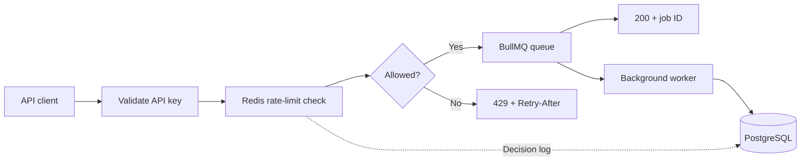
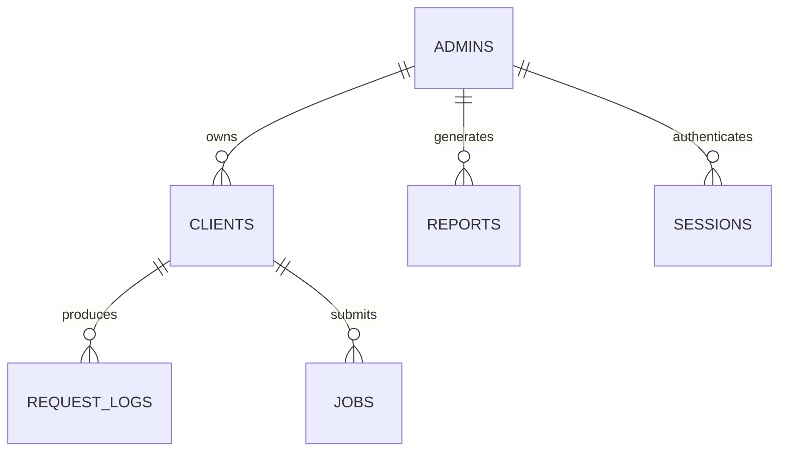

# QueueShield (Distributed API Rate Limiting System)

QueueShield gives each API consumer a request budget and enforces it through shared Redis state. Requests within the limit are accepted and queued for background processing; excess requests receive `429 Too Many Requests`. An admin console manages clients and shows request decisions recorded in PostgreSQL.

A fifth-semester project for academic year **2024–2027**. The focus is the distributed systems mechanism: multiple API processes using the same Redis database enforce one shared limit per client, rather than separate limits in each process.

## Project scope

The synopsis groups the work into five modules. These cover the twelve implementation areas agreed during planning.

| Synopsis module | Implementation areas | Current state |
| --- | --- | --- |
| Admin & Client Registration | 1. JWT admin registration/login; 2. API consumer registration and tier configuration; 11. Admin controls for limits | Registration, cookie sessions, account settings, password changes, notification preferences, account deletion, and client management implemented. |
| Rate Limiting Engine | 3. Token Bucket; 4. Sliding Window Log; 5. Shared distributed state; 6. Request throttling API | Both algorithms use atomic Redis Lua scripts. The demo endpoint is `GET /api/probe`. Concurrent admission across two API instances is integration-tested. |
| Job Queue & Scheduler | 7. Background queue and scheduling; 8. Retry and failure handling | BullMQ worker records processing/completed/failed states. Jobs monitor supports search, status/date filters, and pagination. Three attempts with exponential backoff and durable pending-job reconciliation implemented; a scheduling UI remains outside the current scope. |
| Audit Log & Reports | 9. Persistent audit log; 12. Usage analytics and report generation | Request logs, totals, minute buckets, per-client counts, searchable Activity history, filters, pagination, and current-page CSV export implemented. Saved report generation remains planned. |
| Live Monitoring Dashboard | 10. Throughput and allow/block visualization | Light console with 2.5-second overview polling, a request-count dial, client traffic, recent requests, and a separate Algorithm Lab. |

## Stack

| Layer | Tools |
| --- | --- |
| Admin console | Next.js 16, React 19, TypeScript, Tailwind CSS 4, Recharts 3 |
| API | Node.js, TypeScript, Express, Zod |
| Authentication | bcrypt password hashes, JWT in HTTP-only cookies, revocable PostgreSQL sessions |
| Rate limiting | Redis 7, ioredis, Lua |
| Background processing | BullMQ on Redis |
| Persistent records | PostgreSQL 16, Drizzle ORM |
| Local infrastructure | Production Docker images for Next.js/API; Compose for the complete stack |

The console uses shared styles plus the supplied Reactbits component source, with Motion for animation and Hugeicons for its icons. Application code stays compact; the supplied components retain their original implementation.

## Account experience

- **Profile:** edit name, username, email, phone, and photo. Photos are cropped locally to a 256 px square and stored with the account. Email changes require the current password and revoke other sessions.
- **Username:** 3–24 characters, at least one letter, with letters, numbers, underscores, and hyphens. Names normalize to lowercase, must be unique, and cannot use reserved names such as `admin`, `support`, `root`, or `null`.
- **Password:** 12–72 characters and at most 72 UTF-8 bytes, with uppercase, lowercase, a number, and a symbol. Registration and password changes check [Have I Been Pwned](https://haveibeenpwned.com/API/v3#PwnedPasswords) using only the first five characters of the SHA-1 hash, with response padding. The operation returns `503` if that check is unavailable; it never silently skips the check.
- **Change password:** enter the current password and the new password twice in Settings → Security. A successful change revokes every session. Per the personal-project scope, there is no forgot-password email flow: someone who has forgotten their current password cannot recover the account through this UI.
- **Remember me:** unchecked uses a browser-session cookie with a 12-hour server expiry; checked sets a persistent cookie and server expiry of 30 days. Logout revokes the current session. Cookies are HTTP-only, SameSite=Lax, and Secure when `NODE_ENV=production`. Old local-storage tokens are removed.
- **Notifications:** dashboard traffic notices can be enabled or disabled. Security and product email preferences are stored; email delivery is not connected.
- **Delete account:** requires the current password and typing `DELETE`. Removes the profile, preferences, sessions, owned clients, jobs, request logs, and saved reports. Other accounts are unaffected.
- **Loading:** account initialization and sign-in use full placeholders. During workspace navigation, the sidebar and header stay visible while the destination page uses its own skeleton. Refreshes keep existing data visible; saves and tests show progress and disable duplicate submissions.

The light console uses sage navigation, bordered white panels, and a draggable account flip card with spring motion, pointer tilt, glare, and keyboard controls. Reduced-motion settings disable animations. The dashboard footer no longer lists Redis/PostgreSQL.

## Workspace submodules

The branched sidebar groups six screens into Traffic, Workspace, and Account:

| Screen | What it does |
| --- | --- |
| Overview | Live totals, throughput, client distribution, recent decisions, and real API traffic tests with a draggable request-count dial |
| Activity | Search client/endpoint, filter decision/algorithm/date, paginate recorded requests, and export the visible page as CSV |
| Clients | Register consumers, edit budgets with animated digit slots, and copy keys. Delete starts a four-second outline fuse before the request is sent. Undo or Escape cancels it; hovering again or switching tabs pauses the fuse. Navigating away cancels the pending action. Deletion removes the client and its associated history/jobs after the fuse commits. |
| Jobs | Search job ID/type/client and filter status/date. Shows database worker state, retry count, creation/completion times, and pages of 25 jobs. |
| Algorithm Lab | Compare Token Bucket and Sliding Window with the same bursts, advance a manual clock, inspect token refill/slot expiry, and try a guided example. Runs entirely in the browser; it neither sends requests nor changes client configuration. |
| Settings | Profile, animated notification bells, password changes, and account deletion |

Activity and Jobs refresh every five seconds. Search is debounced and stale requests are cancelled. Skeleton rows appear during initial loads and filter changes; background refreshes retain the displayed rows. CSV export quotes fields and neutralizes values that spreadsheet applications could interpret as formulas.

The supplied Fuse Button, Code Slots, Comet Dial, Branched Menu, Bell Toggle, Call Chip, Rubber Segment, and Flip Card implementations live in `web/components/reactbits/`. The six attached files are copied unchanged; Rubber Segment is extracted from the supplied text bundle, and Flip Card uses the code supplied in chat. Small wrappers connect application state and set colors, labels, and dimensions through props. Spring motion, comet trails, momentum, digit cascades, fuse pause/undo, branch drawing/folding, bell waves, and card tilt/glare remain in the original components. Tailwind 4 supports the supplied utility syntax; small global visibility rules handle component states. Reduced-motion and keyboard behavior follow the supplied components.

## Request flow



The middleware reads the client's configuration from PostgreSQL, then runs the selected algorithm atomically in Redis. Allowed and blocked decisions are logged with an awaited database write; dependency failures fail closed. An allowed probe first creates a durable PostgreSQL job row, then enqueues it under a deterministic BullMQ ID. Queue failure returns 202 and the reconciler retries pending delivery. The current worker simulates work for 200 ms before recording completion.

- **Token Bucket:** starts with `rateLimit` tokens and refills at `rateLimit / windowSeconds` tokens per second. It permits bursts up to the bucket capacity.
- **Sliding Window Log:** stores timestamps for accepted requests in a Redis sorted set and permits at most `rateLimit` requests in the trailing window. Requests can still arrive together when capacity is available.

The algorithms use Redis TIME and separate keys (`rl:tb:<clientId>:<revision>` and `rl:sw:<clientId>:<revision>`). API processes share the same state. Client updates increment the revision and start a fresh budget.

## Database

| Table | Purpose |
| --- | --- |
| `admins` | Name, unique username/email, password hash, phone, photo, preferences, creation time |
| `sessions` | Random session ID, admin, remember-me flag, expiry; cascades on account deletion |
| `clients` | Account owner, name, encrypted API key and unique lookup hash, tier, limit, window, algorithm, revision |
| `request_logs` | Client, endpoint, allow/block status, algorithm, timestamp |
| `jobs` | Client, job type, payload, status, retry count, creation/completion time |
| `reports` | Schema for report type, admin, date range, generation time; not yet populated by the API |



Clients, reports, Activity, and Jobs are scoped to the authenticated owner. Foreign-client edits/deletes return 404. Deleting an account or client cascades through its owned records. Legacy clients with no recorded owner are preserved but hidden and cannot be probed; verified operators can assign and rotate one using `npm run client:assign -- CLIENT_ID ADMIN_ID`. See [AUDIT.md](AUDIT.md) before recovering legacy records.

## Run locally

Docker Desktop with Linux containers is the recommended way to run the production build. First create root `.env` from `.env.example` and replace `JWT_SECRET`, `API_KEY_SECRET`, and `APP_PROXY_SECRET` with different random secrets of at least 32 characters. [AUDIT.md](AUDIT.md#2-local-startup-docker-recommended-for-using-the-application) includes a PowerShell generator and complete instructions.

```powershell
docker compose up --build -d
docker compose ps
```

Open **http://localhost:3000**. Backend: **http://localhost:4000**; PostgreSQL: **localhost:5432**; Redis: **localhost:6379**. Migrations run automatically before the containerized API starts. Named volumes preserve data. `docker compose down` retains data; do not use `down -v` unless intentionally deleting it. Stop any host dev servers using the same ports, or change root host-port settings.

For development, use Node.js 22 and run `docker compose up -d postgres redis`, then `npm ci`, `npm run db:migrate`, and `npm run dev` in `server/`. In another terminal run `npm ci` and `npm run dev` in `web/`. Initialize their environment files from the included examples first. Reuse the same API-key encryption secret when sharing an existing database between Docker and host development.

| File | Variables |
| --- | --- |
| Root `.env` | JWT_SECRET, API_KEY_SECRET, APP_PROXY_SECRET, POSTGRES_PASSWORD, optional WEB_PORT/API_PORT/DB_PORT/REDIS_PORT |
| `server/.env` | DATABASE_URL, REDIS_URL, JWT_SECRET, API_KEY_SECRET, APP_PROXY_SECRET, PORT, WEB_ORIGINS, NODE_ENV, TRUST_PROXY, DB_POOL_SIZE, ALLOW_REGISTRATION |
| `web/.env.local` | Server-only API_URL (default http://localhost:4000), APP_PROXY_SECRET |

The browser calls a same-origin Next.js API proxy; `NEXT_PUBLIC_API_URL` is no longer used. Production cookies are Secure and HttpOnly. Use exact WEB_ORIGINS and matching proxy secrets when deploying. Registration/password changes need outbound HTTPS access to the breach service; SMTP is unnecessary.

### Demo

1. Create an admin account on the sign-in screen.
2. Register a client with a limit of `5` requests per `60` seconds and choose Sliding Window.
3. Open Overview and run a test with `20` requests. A fresh window accepts five and blocks the rest.
4. Check the request activity, client distribution, and recent decisions. The console refreshes every 2.5 seconds.
5. Compare Token Bucket, or change the client budget and run another test. Each configuration change starts a new budget; repeated tests without changes use the same ongoing budget.

To call the probe directly:

```powershell
curl.exe -i http://localhost:4000/api/probe -H "x-api-key: YOUR_CLIENT_KEY"
```

Accepted responses include `X-RateLimit-Remaining` and `X-RateLimit-Status`. Blocked responses include `X-RateLimit-Remaining` and `Retry-After` in seconds. Missing or unknown keys return `401`.

## API

| Method | Route | Access / purpose |
| --- | --- | --- |
| POST | `/api/auth/register` | Public; `{ name, username, email, password, confirmPassword, remember? }`; sets cookie |
| POST | `/api/auth/login` | Public; `{ email, password, remember? }`; sets cookie |
| GET | `/api/auth/me` | Session; current profile and session expiry |
| PATCH | `/api/auth/me` | Session; `{ name, username, email, phone, avatar, currentPassword? }`; password required for email changes |
| PATCH | `/api/auth/notifications` | Session; `{ securityAlerts, trafficAlerts, productUpdates }` booleans |
| POST | `/api/auth/password` | Session; `{ currentPassword, newPassword, confirmPassword }`; revokes all sessions |
| POST | `/api/auth/logout` | Session; revokes current session and clears cookie |
| DELETE | `/api/auth/me` | Session; `{ currentPassword, confirmation: "DELETE" }` |
| GET / POST | `/api/clients` | Session; list or create clients |
| PATCH / DELETE | `/api/clients/:id` | Session; update or delete a client |
| GET | `/api/probe` | `x-api-key`; apply limit and enqueue accepted work |
| GET | `/api/reports/stats` | Session; all-time allowed/blocked totals |
| GET | `/api/reports/timeseries` | Session; recorded full-timestamp minute buckets over the last hour |
| GET | `/api/reports/per-client` | Session; own request counts grouped by client ID and name |
| GET | `/api/reports/logs` | Session; latest 50 decisions |
| GET | `/api/history/activity` | Session; paginated request history with `q`, `status`, `algorithm`, `period`, and `page` |
| GET | `/api/history/jobs` | Session; paginated jobs with `q`, `status`, `period`, and `page` |
| GET | `/health` | Public, uncached process liveness for external cron |
| GET | `/ready` | PostgreSQL/Redis readiness; 200 or 503 |

Admin routes use the `qs_session` cookie. The same session JWT can be supplied as a bearer token by API tools; legacy tokens without a session ID are rejected. Registration, login, password changes, and account deletion are limited to 30 attempts per route/IP in 15 minutes using Redis. Client creation requires `name`, `tier` (`free`, `pro`, or `enterprise`), integer `rateLimit` and `windowSeconds` from 1 to 9,999, and an optional `algorithm` (`token_bucket` or `sliding_window`). Tier is a label; limits are configured explicitly.

History endpoints return `{ rows, counts, total, page, limit: 25 }`, newest first. `period` is `all`, `24h`, or `7d`; activity status is `all`, `allowed`, or `blocked`; job status is `all`, `queued`, `processing`, `completed`, or `failed`. Activity's `algorithm` is `all`, `token_bucket`, or `sliding_window`. Counts reflect the current filters. Job payloads and API keys are omitted from history responses.

## Deployment and project audit

[AUDIT.md](AUDIT.md) contains startup/troubleshooting, Vercel/Render configuration, every major UI/backend mechanism, the ownership migration, security decisions, database design, queue recovery, testing evidence, and 72 project-review questions and answers.

Deploy Vercel with Root Directory `web`, `API_URL=https://your-api.onrender.com`, and the shared `APP_PROXY_SECRET`. Use `render.yaml` or the backend Dockerfile for Render; set database/Redis URLs, all three secrets, `NODE_ENV=production`, `TRUST_PROXY=1`, and your exact frontend `WEB_ORIGINS`. Set Render?s health-check path to `/ready`.

For an external ten-minute cron, send `GET https://your-api.onrender.com/health` on `*/10 * * * *`; no credentials or API key are needed. It creates no traffic/jobs. Render free services can still restart or exhaust quotas; free PostgreSQL expires after 30 days and free Key Value loses state on restart. Durable production data needs suitable hosting and backups. [Render free-service details](https://render.com/docs/free).

Scheduled-job controls, real task side effects, full-history exports, and saved reports remain outside the current application. The limiter protects the probe endpoint rather than arbitrary upstream APIs. Job delivery is at least once; real side effects require idempotency. Public deployment still needs hosting credentials, monitoring/backups, capacity controls, and verification on the actual domains. Code hardening and local tests do not provide an availability guarantee.

## Repository

```text
server/src/
  routes/       authentication, clients, probe, analytics, history
  ratelimit/    Redis Lua algorithms and Express middleware
  db/           Drizzle schema, connection, migration runner
  queue.ts      BullMQ queue and worker
web/
  app/          login, overview, activity, clients, jobs, algorithm lab, settings
  components/   shell, chart, traffic tester, skeletons, compact interactive controls
  lib/          API calls and auth state
docker-compose.yml
```

Build checks: `npm run build` in `server/` and `web/`. Run `npm test` in `server/` for account validation, breach-service privacy/failure checks, authenticated API-key encryption, algorithm simulation boundaries, and safe CSV encoding.

For an isolated production preview while `next dev` is running, set `$env:NEXT_BUILD_DIR = ".next-preview"` before building and starting a production preview in another terminal. This keeps the build output separate from the development server.

The opt-in integration tests create unique temporary accounts and records, then remove their fixtures. They cover account changes/session revocation, history search/filter/pagination, protected job access, and cascading client deletion, cross-account isolation, multi-instance Redis concurrency, and completed queued work. They need the migrated local API, databases, and access to the breach service:

```powershell
cd server
$env:TEST_API_URL = "http://localhost:4000"
npm run test:integration
```

Browser verification: run `npm run test:browser` in `web/` with TEST_WEB_URL pointing to a running production frontend. Playwright installation and complete validation instructions are in [AUDIT.md](AUDIT.md#16-verification-commands-and-audit-record).
